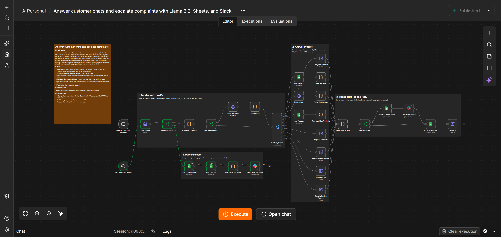
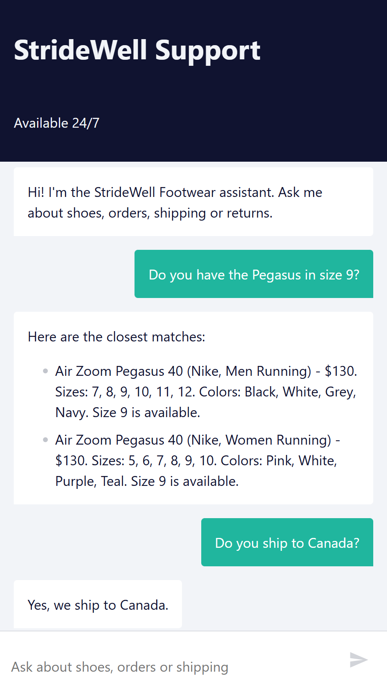
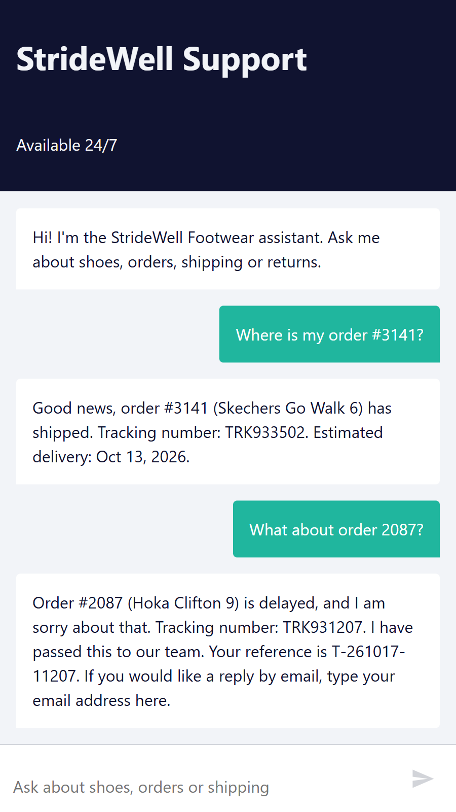
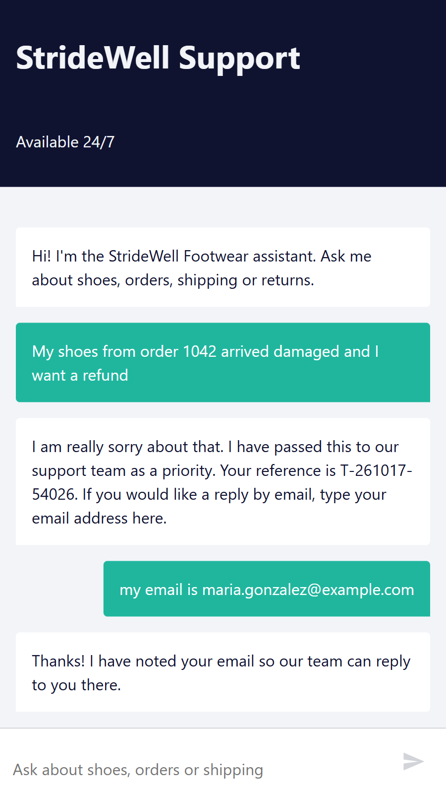
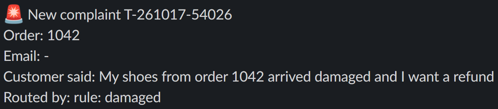
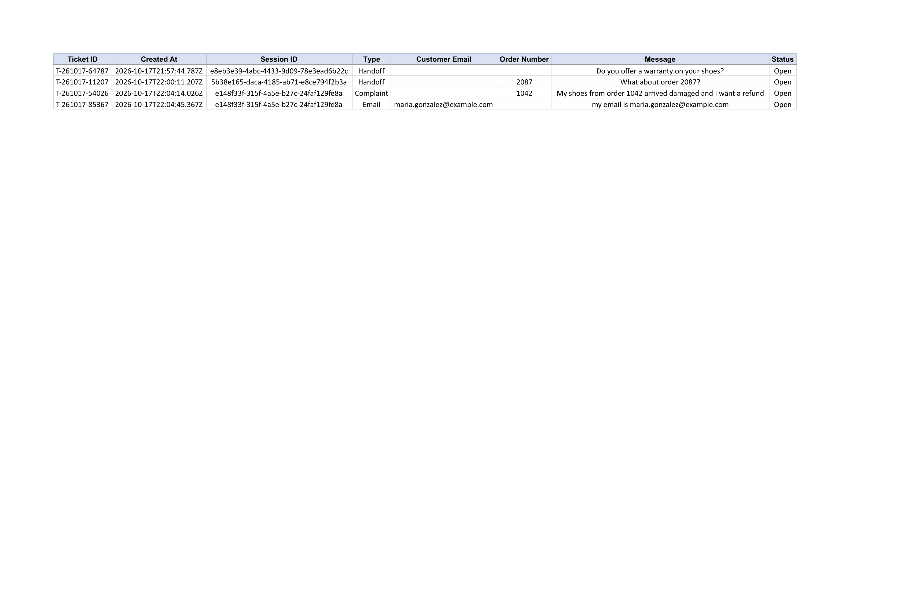
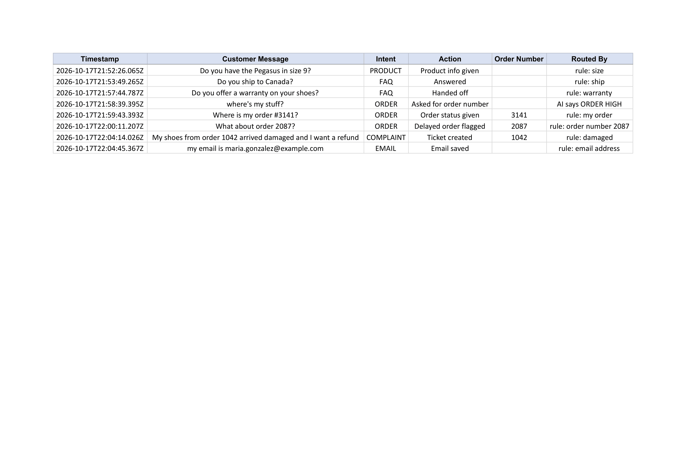
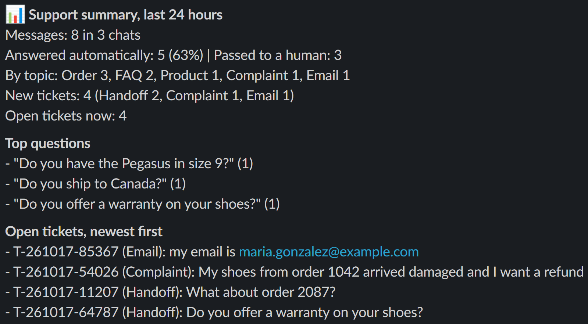

# AI Customer Support & Sales Agent

> An AI-powered n8n automation that answers customer chats around the clock — product questions, order status, and store FAQs — hands complaints and anything it can't answer to a human with a ticket and a Slack alert, and sends the owner a daily summary — built for **StrideWell Footwear** (demo brand).

## The Problem

Small online stores can't afford 24/7 support staff. A customer who messages at night gets no reply and often buys from a competitor instead — every question answered late is a potential lost sale. And when replies do happen, the owner has no clear picture of what customers are actually asking, or which problems are piling up.

## The Solution

This workflow turns every customer chat message into the right answer — or the right human — within seconds, with zero manual work:

1. A customer writes in the chat (n8n's built-in Chat Trigger — a hosted chat page, or an embeddable widget for the store's own site)
2. **Keyword rules in code** place the message as a product question, order-status question, FAQ, complaint, human request, email address, or small talk — instantly, at no AI cost
3. Only messages the rules can't place go to the AI, and its label is trusted **only with HIGH confidence** — anything less goes to a person instead of being guessed at
4. **Product questions** are answered straight from the Products sheet: brand, category, gender, color, size, and price are read from the message, and the reply lists real prices and available sizes — nothing is invented
5. **Order-status questions** look the order up in the Orders sheet and answer in code (processing, shipped with tracking, out for delivery, delivered, delayed, cancelled), so details can never be made up
6. **Store questions** (shipping, returns, payment, hours) are answered by the AI strictly from the store info in one config node — if the answer isn't there, it says so and hands off
7. **Complaints, delayed orders, human requests, and unclear messages** create a ticket with a reference number for the customer and send a Slack alert to the team; if the customer leaves an email, it's saved to the Tickets sheet and the team is alerted
8. Every message is logged with how it was routed (a keyword rule, or the AI's answer), and a **daily summary** posts to Slack: messages handled, share answered automatically, new and open tickets, and the most repeated questions

## Tech Stack

- **n8n** — workflow orchestration (self-hosted via Docker)
- **n8n Chat Trigger** — hosted chat page or embeddable widget, no extra account needed
- **Ollama (Llama 3.2)** — local, free LLM for FAQ wording and for classifying unclear messages during development
- **Google Sheets** — product catalog, orders, conversation log, and support tickets
- **Slack** — escalation alerts and the daily summary
- **JavaScript (n8n Code nodes)** — intent rules, product search, order lookup, ticket logic, daily stats

> Llama 3.2 (free, local) was used for development and demo purposes. Production client deployments swap in GPT-4o or Claude for higher-quality output — the workflow architecture stays identical.

> **Sample sheet:** `Support-Agent-Data.xlsx` contains the four tabs the workflow expects (Products, Orders, Conversations, Tickets) with every column header, the 87-product demo catalog, and 12 fictional demo orders. Upload it to Google Drive, open it with Google Sheets, and use **File > Save as Google Sheets** — the workflow reads native Google Sheets, not `.xlsx` files.

## Architecture

```
CHAT PATH (every customer message)
1. Receive Customer Message             (Chat Trigger)
        ↓
2. Load Config                          (store name and info, sheet ID, Slack channel, model — edited in one place)
        ↓
3. Detect Intent by Rules               (Code: product, order, FAQ, complaint, human request, email, small talk)
        ↓
4. Needs AI Fallback?                   (only messages the rules could not place continue)
        ↓
5. Classify Unclear Message → Parse AI Intent    (AI label accepted only with HIGH confidence, otherwise "other")
        ↓
6. Route by Intent                      (Switch: 8 outputs)
        ↓
7. One branch answers
   Product      Load Products → Find Matching Products      (Code: filters brand, category, gender, color, size, price)
   Order        Load Orders → Look Up Order                 (Code: writes the status reply)
   FAQ          Answer FAQ → Parse FAQ Answer               (AI answers only from the store info, or hands off)
   Complaint / Human request / Email / Unclear message      (fixed reply, flagged for a human)
   Small talk   Reply to Smalltalk
        ↓
8. Prepare Reply Data                   (Code: ticket reference, formula-safe text, "routed by" note)
        ↓
9. Needs Human?                         (if yes: Create Support Ticket → Alert Owner on Slack)
        ↓
10. Log Conversation → Set Reply        (Google Sheets log, then the reply goes back to the chat)

DAILY SUMMARY (independent schedule, shares Load Config)
1. Daily Summary Trigger                (Schedule Trigger, every day at 8:00)
        ↓
2. Load Conversations → Load Tickets    (Google Sheets)
        ↓
3. Build Daily Summary                  (Code: counts, automation rate, top questions, open tickets)
        ↓
4. Send Daily Summary                   (Slack)
```

## Key Features

- **Rules first, AI second** — predictable intents are handled by keyword rules in code (instant and free); the AI only sees what the rules miss, and code verifies its answer. A wrong label ends in a harmless clarifying question or a handoff, never a wrong answer
- **No invented facts** — product details and order status come only from the sheets, and FAQ answers only from the store info, with a fixed `NOT_SURE` escape that triggers a human handoff instead of a guess
- **Human handoff with a paper trail** — every escalation gets a ticket reference for the customer, a row in the Tickets sheet, and a Slack alert; customers can leave an email address, which is saved and flagged to the team
- **Works without the AI** — if the model is down, only FAQ wording and the unclear-message fallback degrade, and both turn into clean handoffs; products, orders, tickets, and logging keep working
- **Safe with untrusted text** — customer messages are guarded against spreadsheet formula injection and escaped before they reach Slack
- **One config node** — store info, sheet ID, Slack channel, and model name live in a single node, so setting up a new store means editing one place
- **Transparent logging** — every row records the intent, the action taken, and how the message was routed (the matched keyword or the AI's answer)
- **Daily owner summary** — a scheduled message with volumes, automation rate, new and open tickets, and the most repeated questions, so the owner sees support quality without opening a spreadsheet

## Screenshots

|  |  |
| --- | --- |
| **Workflow Overview**<br>[](screenshots/01_workflow_overview.png) | **Product Search + FAQ**<br>[](screenshots/02_product_search_chat.png) |
| **Order Status + Delayed Order**<br>[](screenshots/03_order_status_chat.png) | **Complaint + Email Capture**<br>[](screenshots/04_complaint_handoff_chat.png) |
| **Slack Escalation Alert**<br>[](screenshots/05_slack_alert.png) | **Support Tickets Sheet**<br>[](screenshots/06_support_tickets_sheet.png) |
| **Conversation Log**<br>[](screenshots/07_conversation_log_sheet.png) | **Daily Summary**<br>[](screenshots/08_daily_summary_slack.png) |

## Future Enhancements

- Conversation memory, so a customer can narrow a product search across several messages
- Ask for the order email before sharing order details, as a second check on order lookups
- Live Shopify or WooCommerce order sync (for example, an orders webhook that fills the Orders sheet)
- WhatsApp or email as channels alongside the web chat
- Rate limiting and spam protection for a public chat link
- Dedicated error-handling workflow with Slack alerts on failure

## Live on n8n's Official Template Library

This workflow was reviewed and published to n8n's official public template library: [Answer customer chats and escalate complaints with Llama 3.2, Google Sheets, and Slack](https://n8n.io/workflows/21195-answer-customer-chats-and-escalate-complaints-with-llama-32-google-sheets-and-slack)

## Author

**Shaharuk Anik** — AI Automation Specialist | Verified n8n Creator

[](https://www.linkedin.com/in/shaharukanik) [](mailto:shaharukianik@gmail.com) [](https://gorgeous-kilometer-192.notion.site/AI-Customer-Support-Sales-Agent-3fd8dcd3964c812ba8e9fbc26827768e)
